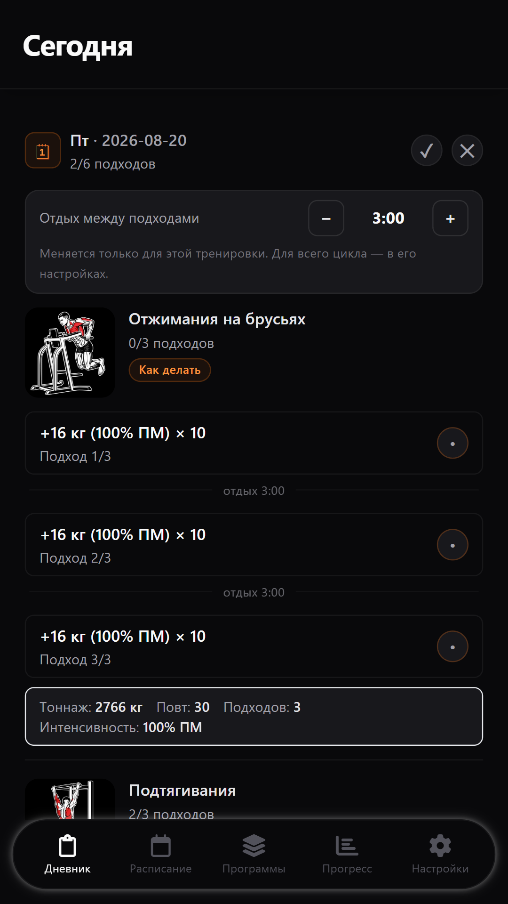
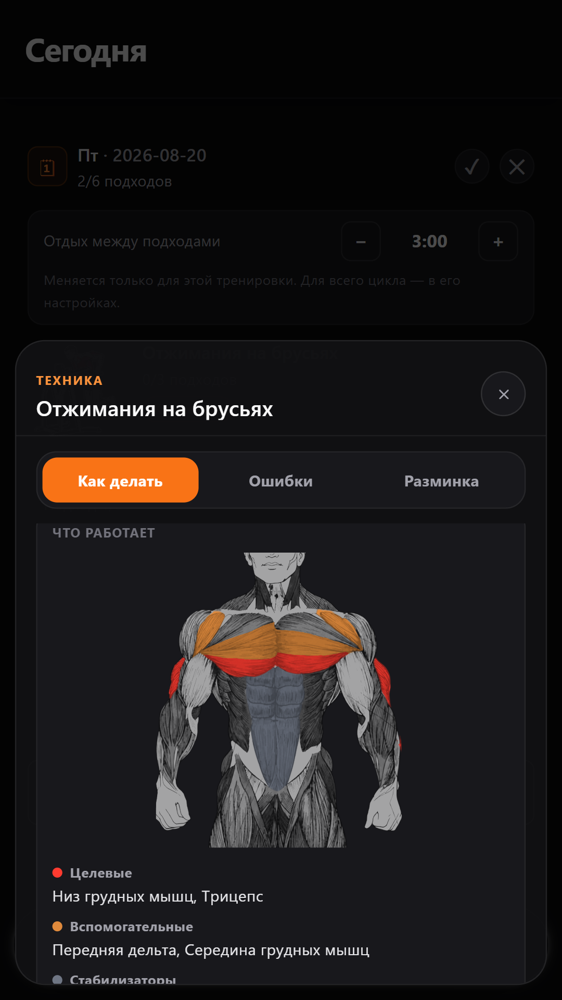
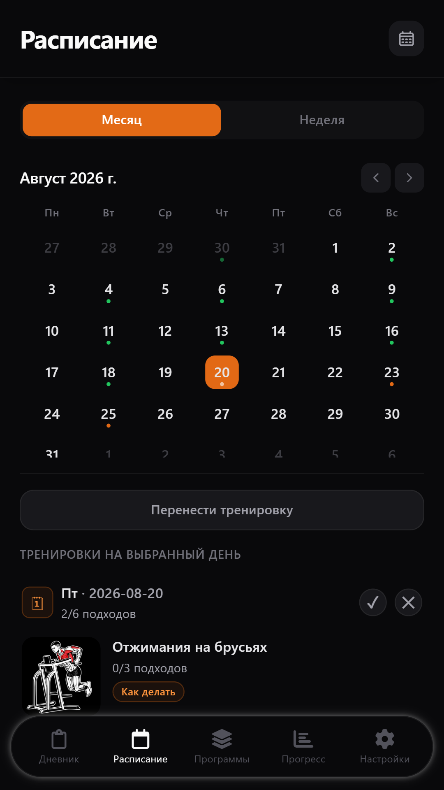
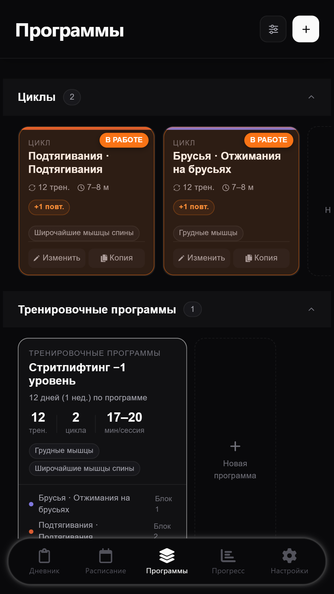
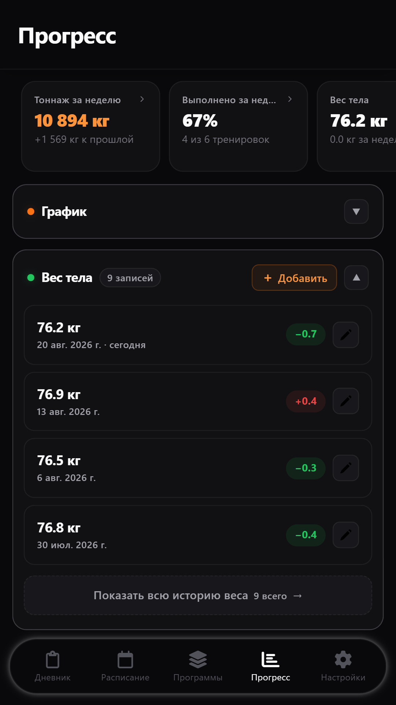
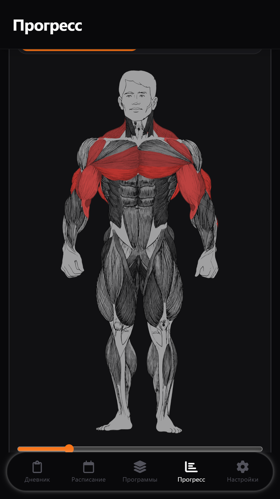
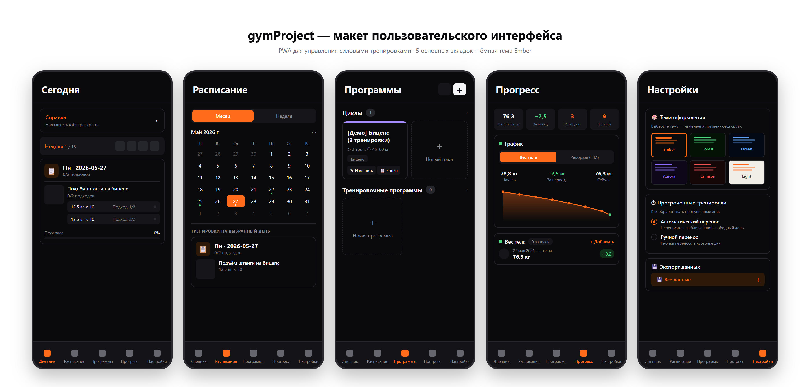

# 🏋️ gymProject

**Дневник силовых тренировок для тех, кто занимается по плану, а не по настроению**

Циклы → программы → тренировки → подходы. Работает без интернета, данные остаются на телефоне.

[**🌐 Веб-демо**](https://tixoni.github.io/gymProject_production/) · [**🎬 Видео-обзор**](video_2026-06-20_13-09-52.mp4)

---

## 📱 Скриншоты

<table>
  <tr>
    <td align="center"> <b>Сегодня</b> подходы, % от ПМ, таймер отдыха</td>
    <td align="center"> <b>Техника</b> целевые и вспомогательные мышцы</td>
    <td align="center"> <b>Расписание</b> календарь тренировок</td>
  </tr>
  <tr>
    <td align="center"> <b>Программы</b> циклы и программы по дням недели</td>
    <td align="center"> <b>Прогресс</b> тоннаж, рекорды, вес тела</td>
    <td align="center"> <b>Карта мышц</b> нагрузка по мышечным группам</td>
  </tr>
</table>

<b>🎨 Обзор всех вкладок одним макетом</b>

 

---

## ✨ Возможности

| | |
|---|---|
| 📋 **План вместо записей** | Цикл — схема нагрузки для упражнения, программа — циклы по дням недели. Даты сами встают в календарь |
| 🎯 **Веса от личного максимума** | Вес подхода в кг или в % ПМ. Обновили рекорд — пересчиталась вся программа |
| ⏱️ **Таймер отдыха** | Уведомление приходит даже при свёрнутом приложении и погашенном экране |
| 📈 **Прогресс** | Тоннаж по неделям, мышечным группам и упражнениям, история рекордов, оценка максимума по повторам |
| 🫀 **Карта мышц** | Анатомическая карта показывает, какие мышцы и насколько нагружены |
| 💾 **Данные у вас** | Автокопия в «Документах» переживает переустановку, хранится 7 копий, экспорт/импорт JSON и CSV |
| 🌗 **Шесть тем** | Тёмные и светлая, переключаются мгновенно |

---

## 🛠 Под капотом

| Слой | Технологии |
|---|---|
| UI | React 18 · Tailwind CSS 3 |
| Логика и хранилище | TypeScript · Dexie 4 (IndexedDB) — offline-first |
| Мобильная оболочка | Capacitor 8 (Android) · локальные уведомления |
| Сборка и качество | Vite 5 · Vitest · ESLint · TypeDoc |
| Веб-версия | облачная синхронизация, бэкенд на NestJS |

---

🔒 **Исходный код закрыт.** Этот репозиторий — витрина проекта: скриншоты, видео и веб-демо.

Автор — [@Tixoni](https://github.com/Tixoni)

